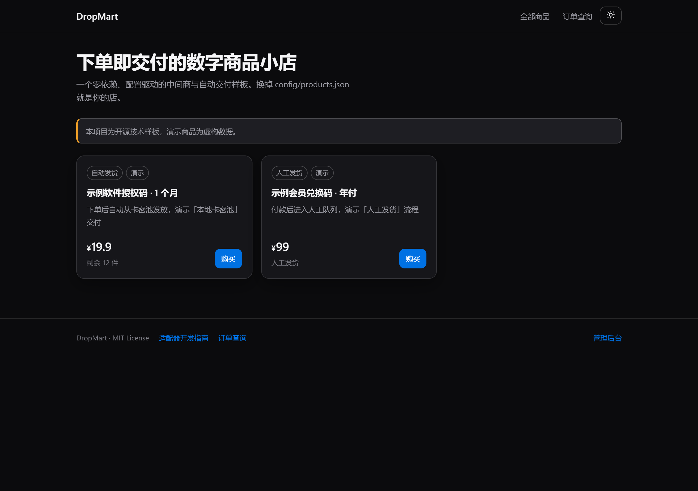
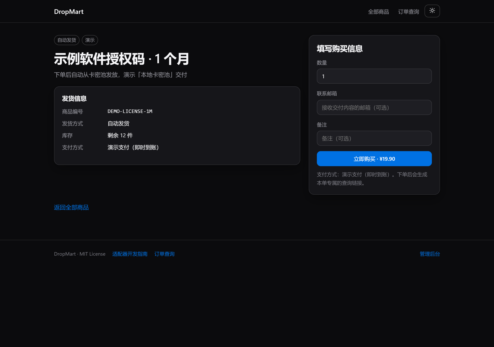
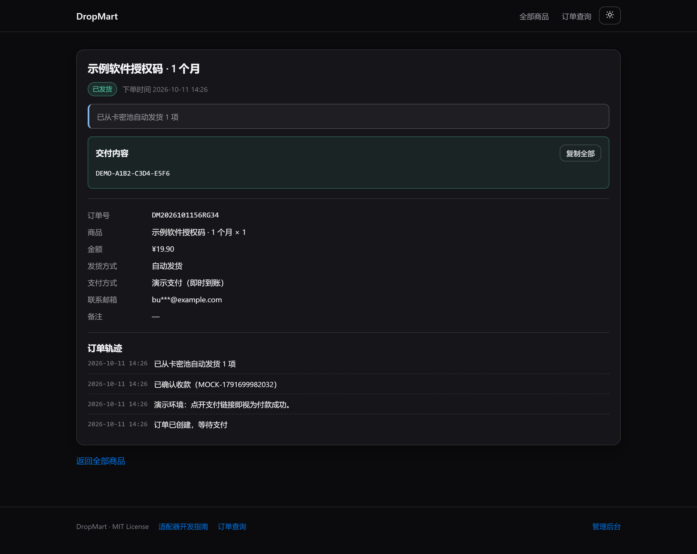
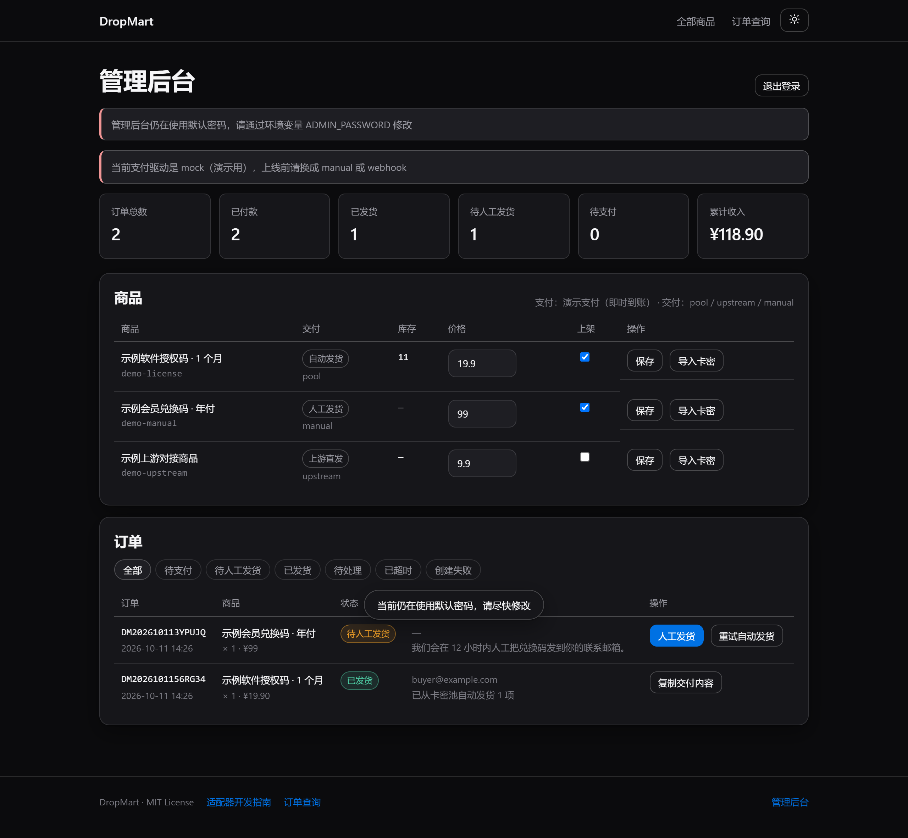
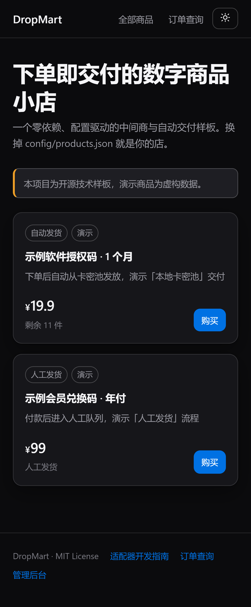

# DropMart

> 零依赖的「中间商 + 自动交付」商城骨架 —— 配置驱动、适配器可插拔的数字商品销售系统。


**English** — DropMart is a zero-dependency storefront boilerplate for reselling and automated
delivery. Define your catalog in JSON, plug in a payment driver and a fulfilment driver, and you
get order management, automated key delivery, an admin console and a customer-facing order lookup
out of the box. No build step, no database, no `npm install` — just `node server.js`.

---

## 目录

- [它解决什么问题](#它解决什么问题)
- [30 秒跑起来](#30-秒跑起来)
- [界面](#界面)
- [核心概念](#核心概念两个适配器)
- [三种内置交付方式](#三种内置交付方式)
- [配置参考](#配置参考)
- [接入你自己的支付通道](#接入你自己的支付通道)
- [目录结构](#目录结构)
- [部署](#部署)
- [上线前安全清单](#上线前安全清单)
- [测试](#测试)
- [设计取舍](#设计取舍)
- [参考与致谢](#参考与致谢)
- [合规声明](#合规声明)

---

## 它解决什么问题

做「中间商」这件事，业务逻辑其实很简单：**顾客在你的站点下单付钱 → 你去上游取货 → 把货交给顾客**。
麻烦的是外围那一圈：支付回调验签、库存扣减、重复发货、订单查询凭证、人工兜底、后台对账。

现成的开源方案都很好，但都很重。独角数卡要 PHP + MySQL + Redis + Supervisor，CardVerse 要
NestJS + Prisma + MySQL + 两个前端工程，GeekFaka 要 Next.js + Prisma。它们功能确实全，可如果你只是
想先跑通一条链路、或者想把它当成自己产品的起点，光是把环境搭起来就够劝退了。

DropMart 的判断是：**把复杂度还给配置，把可扩展性交给适配器。** 于是有了这些取舍：

| 取舍 | DropMart 的选择 | 代价 |
| --- | --- | --- |
| 依赖 | **0 个运行时依赖**，只用 Node 内置模块 | 没有 ORM、没有模板引擎，UI 用原生 DOM |
| 存储 | 扁平 JSON 文件 + 原子写 + 单进程写锁 | 到几万订单量级需要换成数据库 |
| 构建 | **无构建步骤**，改完刷新即可 | 没有 TS 类型和打包优化 |
| 扩展 | 交付 / 支付都是**一个文件 + 一行注册** | 高级功能（优惠券、多规格、用户体系）需要自己加 |

换句话说：**它不做大而全的电商，只把「中间商 + 自动交付」这一条链路做到又短又快。**

---

## 30 秒跑起来

```bash
git clone https://github.com/Z-zero-XT/dropmart.git
cd dropmart
node server.js
```

打开 <http://127.0.0.1:8787> 就能看到一个带演示商品的店铺。管理后台在 <http://127.0.0.1:8787/admin>，
默认密码 `admin`（**仅为本地演示，上线必须改**）。

不需要 `npm install` —— 项目没有任何依赖。

想跑完整测试：

```bash
npm test          # 等价于 node scripts/smoke-test.js
```

---

## 界面

| 前台 | 商品详情 |
| --- | --- |
|  |  |

| 订单取货 | 管理后台 |
| --- | --- |
|  |  |

移动端自适应，明暗主题一键切换：



---

## 核心概念：两个适配器

整个系统只有两个扩展点。想换货源、换支付，你**不需要改订单流程，也不需要改前端**。

```
                        ┌──────────────────────────────┐
   顾客                │          你的 DropMart         │              上游 / 渠道
                        │                              │
  ┌─────────┐  下单     │  ┌────────────────────────┐  │   调用接口    ┌────────────┐
  │  浏览器  │ ────────► │  │  支付适配器             │  │ ───────────► │ 支付网关    │
  │         │           │  │  mock / manual / webhook│  │              └────────────┘
  └────┬────┘           │  └────────────────────────┘  │
       │                │                              │   取货        ┌────────────┐
       │  取货          │  ┌────────────────────────┐  │ ───────────► │ 上游供货 API│
       └─────────────── │  │  交付适配器             │  │              └────────────┘
                        │  │  pool / upstream / manual│ │
                        │  └────────────────────────┘  │   扣库存      ┌────────────┐
                        │                              │ ───────────► │ 本地卡密池  │
                        │  订单状态机 + JSON 存储       │              └────────────┘
                        └──────────────────────────────┘
```

**交付适配器**回答两个问题：这一单怎么发货？还剩多少货？

```js
// src/adapters/delivery/my-supplier.js
module.exports = {
  name: 'my-supplier',
  async deliver(order, product, ctx) {
    return { ok: true, items: ['交付内容'], message: '已发货' };
  },
  stock(product) {
    return -1; // -1 表示未知或不限
  },
};
```

**支付适配器**负责创建支付链接，以及校验回调。

```js
// src/adapters/payment/my-gateway.js
module.exports = {
  name: 'my-gateway',
  label: () => '我的支付通道',
  async createPayment(order, ctx) {
    return { ok: true, payUrl: 'https://pay.example.com/?out=' + order.id };
  },
  verifyCallback(payload, ctx) {
    return { ok: true, orderId: payload.orderId, amount: Number(payload.amount) };
  },
};
```

写完各自在 `src/adapters/*/index.js` 里 `register()` 一行即可生效。
详细的字段说明见站内 `/guide.html` 页面或 [docs/architecture.md](docs/architecture.md)。

---

## 三种内置交付方式

| 方式 | 行为 | 适用场景 |
| --- | --- | --- |
| `pool` | 从 `data/stock/*.txt` 里取号，**取走的行会被真正删除** | 你手上有现成的卡密、兑换码、授权码 |
| `upstream` | 调用上游接口取货，支持请求体模板和响应取值路径 | **中间商模式**：绑定供应商，由供应商履约 |
| `manual` | 付款后进人工队列，你在后台填交付内容 | 低频、需要人工核对、上游暂时没有 API |

`upstream` 是最能体现「中间商」的一种，它把上游接口的差异都收进了配置里：

```jsonc
{
  "id": "my-product",
  "title": "某某会员 30 天",
  "price": 29.9,
  "delivery": "upstream",
  "deliveryConfig": {
    "url": "https://supplier.example.com/api/issue",
    "method": "POST",
    "headers": { "Authorization": "Bearer YOUR_TOKEN" },
    "body": {
      "sku": "{{sku}}",
      "quantity": "{{qty}}",
      "reference": "{{orderId}}"
    },
    "itemsPath": "data.items",
    "itemField": "code",
    "timeoutMs": 10000,
    "stock": 500
  }
}
```

可用占位符：`{{qty}}` `{{orderId}}` `{{sku}}` `{{productId}}`。

---

## 配置参考

### `config/site.json` —— 站点级配置

| 字段 | 说明 |
| --- | --- |
| `name` / `tagline` / `description` | 站点名、副标题、简介 |
| `currency` | 货币符号，默认 `¥` |
| `announcement` | 全站公告，留空则不显示 |
| `theme.accent` | 主题色，会写进 CSS 变量 |
| `theme.defaultMode` | `dark` 或 `light` |
| `order.maxQuantity` | 单笔最大购买数量 |
| `order.expireMinutes` | 超过多久未支付自动关单 |
| `payment.driver` | 当前启用的支付适配器名 |
| `payment.drivers.*` | 各支付适配器自己的配置 |
| `delivery.webhookNotifyUrl` | 发货后把订单推送到这个地址（带 HMAC 签名） |
| `admin.path` | 后台路径，建议改成一个猜不到的字符串 |

### `config/products.json` —— 货盘

```jsonc
{
  "products": [
    {
      "id": "demo-license",          // 唯一标识，会出现在 URL 里
      "title": "示例软件授权码",
      "subtitle": "一句话说明",
      "price": 19.9,
      "tags": ["自动发货"],           // 前台展示的标签
      "active": true,                 // false 即下架
      "delivery": "pool",             // 交付适配器名
      "deliveryConfig": { "file": "data/stock/demo-code.txt" },
      "sku": "DEMO-LICENSE-1M"        // 传给上游的商品编号
    }
  ]
}
```

> 只改配置，就能开一家新店。这也是这个项目被设计成「流程可挪用」的方式：
> 别人 clone 下来，替换 `config/` 和 `data/stock/`，就是他自己的一套系统。

### 环境变量

见 [.env.example](.env.example)。三个必须关注的：

| 变量 | 用途 |
| --- | --- |
| `ADMIN_PASSWORD` | 后台密码。不设置就用默认值，非常危险 |
| `APP_SECRET` | 支付回调签名与 token 加盐。建议 `openssl rand -hex 32` |
| `PUBLIC_URL` | 对外可访问的地址。不设置会导致支付回调指向本机 |

另外 `PORT`、`HOST`、`DROPMART_CONFIG_DIR`、`DROPMART_DATA_DIR` 也可覆盖。

---

## 接入你自己的支付通道

如果内置的三种不够用，写一个支付适配器是最快的方式。下面是一个「跳转 + 回调」的最小实现：

```js
'use strict';
const { hmacHex, safeEqual } = require('../../util');

module.exports = {
  name: 'acme-pay',
  label: () => '信用卡支付',

  async createPayment(order, ctx) {
    const cfg = ctx.site.payment.drivers['acme-pay'];
    return { ok: true, payUrl: `${cfg.baseUrl}/checkout?ref=${order.id}` };
  },

  verifyCallback(payload, ctx) {
    const cfg = ctx.site.payment.drivers['acme-pay'];
    if (!safeEqual(hmacHex(cfg.secret, payload.ref), payload.sign)) {
      return { ok: false, message: '验签失败' };
    }
    return { ok: true, orderId: payload.ref, amount: Number(payload.amount) };
  },
};
```

注册：`src/adapters/payment/index.js` 里加 `register('acme-pay', require('./acme-pay'));`，
然后把 `config/site.json` 的 `payment.driver` 改成 `acme-pay`。

内置的 `webhook` 适配器已经处理了最常见的「签名跳转 + 异步回调」模式，字段名兼容
`orderId|order_id|out_trade_no` 与 `amount|money|total_fee` 等常见别名，多数网关直接配置即可使用。

---

## 目录结构

```
dropmart/
├── server.js                      # 入口：路由、静态资源、启动
├── config/
│   ├── site.json                  # 站点配置
│   └── products.json              # 货盘
├── src/
│   ├── adapters/
│   │   ├── delivery/              # 交付适配器：pool / upstream / manual
│   │   └── payment/               # 支付适配器：mock / manual / webhook
│   ├── api/
│   │   ├── public.js              # 公开接口
│   │   └── admin.js               # 后台接口
│   ├── orders.js                  # 订单状态机与履约编排
│   ├── store.js                   # JSON 存储 + 写锁
│   ├── config.js                  # 配置加载
│   ├── http.js / util.js          # 工具函数
│   └── admin-auth.js              # 后台会话
├── public/                        # 前台（无构建，原生 HTML/CSS/JS）
│   ├── index.html / product.html / order.html / admin.html / guide.html
│   ├── app.js / styles.css / favicon.svg
├── data/                          # 运行时数据（订单库 + 卡密池）
├── scripts/smoke-test.js          # 冒烟测试
└── docs/                          # 架构与部署文档
```

### 订单状态机

```
pending          下单完成，等待支付
  ├─ expired     超过 expireMinutes 未支付，自动关单
  ├─ failed      创建支付时出错
  └─ paid        收到款项
       ├─ delivered        交付成功，顾客可凭 token 取货
       └─ pending_manual   进入人工队列，等管理员发货
```

---

## 部署

### Docker

```bash
cp .env.example .env      # 改掉 ADMIN_PASSWORD 和 APP_SECRET
docker compose up -d
```

`data/` 会被挂载成持久卷。更细的部署说明（systemd / Nginx / HTTPS / 反向代理）见
[docs/deployment.md](docs/deployment.md)。

### 直接跑

```bash
ADMIN_PASSWORD='你的强密码' \
APP_SECRET="$(openssl rand -hex 32)" \
PUBLIC_URL='https://shop.example.com' \
HOST=0.0.0.0 PORT=8787 \
node server.js
```

建议放在 Nginx 或 Caddy 后面由它们负责 HTTPS —— 本服务只监听 HTTP，不处理证书。

---

## 上线前安全清单

- [ ] `ADMIN_PASSWORD` 已改成强密码（不改的话后台任何人都能进）
- [ ] `APP_SECRET` 已用随机值设置
- [ ] `PUBLIC_URL` 已设置成外部可访问地址
- [ ] `payment.driver` 已从 `mock` 换成 `manual` 或 `webhook`
- [ ] `admin.path` 已改成一个猜不到的路径
- [ ] `data/` 目录已排除在版本控制外（`.gitignore` 默认已处理）
- [ ] 已配置 HTTPS 反向代理
- [ ] 已确认所售商品拥有合法授权（见下方合规声明）

---

## 测试

```bash
npm test
```

冒烟测试会自己在系统临时目录造一份隔离配置，起一个**伪造的上游供货服务**，然后用这份配置启动真实
的服务端，把三条交付链路和支付回调全跑一遍：

```
基础接口                    4 项
卡密池链路（pool）          9 项  含库存扣减、重复支付幂等
上游对接链路（upstream）    1 项
人工发货链路（manual）      9 项  含后台鉴权、人工发货、卡密导入去重、改价
通用支付网关（webhook）     3 项  含验签失败与金额校验
静态页面                    9 项
```

共 35 项断言。测试不会碰项目里的 `data/` 目录。

---

## 设计取舍

- **为什么用 JSON 文件而不是 SQLite？** 零依赖、可读、可直接编辑、方便备份和迁移，
  对单机小店完全够用。订单量上到几万条时，把 `src/store.js` 换成数据库实现即可 ——
  对外只暴露 `transact()` / `readOrder()` / `listOrders()`，上层代码不用动。
- **为什么不用框架？** 这套系统的页面只有五个，业务逻辑集中在 `src/orders.js`。
  引入框架带来的抽象成本大于收益，而且会让「别人拿去改」的门槛变高。
- **为什么交付和支付要做成适配器？** 因为这两块是最容易变的。货源会换、支付通道会换，
  把它们隔离出来，业务代码就永远不用改。
- **安全边界在哪？** 卡密池文件被限制在 `data/stock/` 目录内，即使有人改了配置也无法
  利用它读取服务器上的任意文件；后台会话存在内存中，重启即失效；订单查询必须带 token。

---

## 参考与致谢

设计过程中参考了这些优秀的开源项目，它们各自的取舍给了这个项目很多启发：

| 项目 | 技术栈 | 借鉴的地方 |
| --- | --- | --- |
| [独角数卡 dujiaoka](https://github.com/assimon/dujiaoka) | PHP / Laravel | 卡密池模型、支付驱动分离、上游对接的完整形态 |
| [CFFK / EdgeKey](https://github.com/34892002/cffk) | Cloudflare Workers + D1 | 上游供应商绑定、库存成本同步、浏览器缓存历史订单 |
| [CardVerse](https://github.com/JenkinWoo/CardVerse) | NestJS + Prisma | 发货后 webhook 外推、自动与人工发货并存 |
| [GeekFaka](https://github.com/rimac3/GeekFaka) | Next.js + Prisma | 可扩展支付网关、灵活的发货格式解析 |
| [Orion Key](https://github.com/Lance-Mao/orion-key) | Next.js + Spring Boot | 把「可扩展的支付架构」当作一等公民 |
| [kamiFaka](https://github.com/Baiyuetribe/kamiFaka) | Vue3 + Flask | 多主题与前后台分离的组织方式 |

它们的共同缺点是部署成本高；DropMart 的差异就是把这套模型压缩到一个零依赖进程里。

---

## 合规声明

**本项目是技术骨架，不附带任何货盘，也不代为销售任何商品。**

使用者需要自行确保所售商品满足以下全部条件：

- 拥有合法的销售授权或完整的所有权；
- 不涉及他人账号、身份信息、手机号、验证码等个人信息；
- 不涉及盗刷资金、区域价差套利、绕过平台风控等行为；
- 不涉及仿冒品、盗版软件或受出口管制的服务；
- 符合你所在司法辖区的全部法律法规与支付服务商规则。

典型的合法用法包括：销售你自己制作的数字产品、拥有授权分销权的商品，
以及官方提供分销或联盟计划的 SaaS 服务。

**转售他人账号、售卖验证码、代充灰色订阅等行为在中国大陆可能触及帮助信息网络犯罪活动罪、
侵犯公民个人信息罪等罪名。** 开源许可不等于合规许可，使用本项目产生的全部法律责任由使用者自行承担。

---

## License

[MIT](LICENSE)
